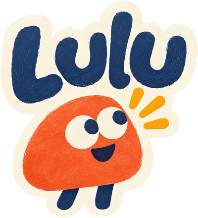
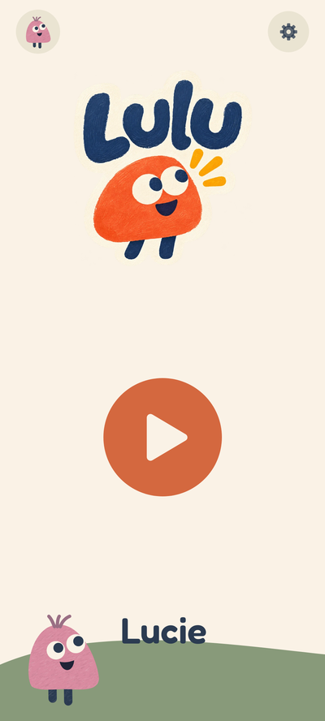
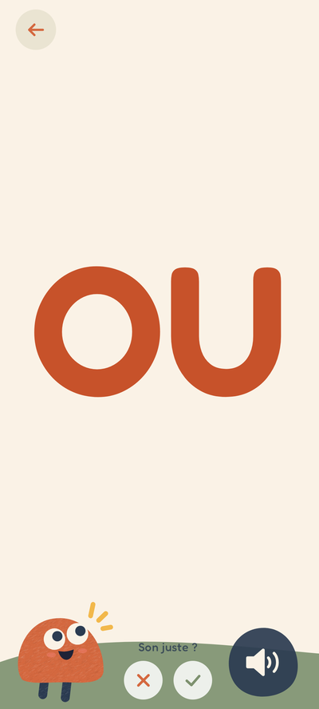

<p align="center">
  
</p>

<h3 align="center">Learning to read in French, one sound at a time</h3>
<p align="center"><i>Apprendre à lire en français, un son à la fois</i></p>

Lulu is an Android app that teaches young children, from age 3, to read
**French**. It teaches the sounds of French letters and letter groups, such as
« a », « ou », « ch » or « on », in the order that research on learning to read
French recommends, and it uses spaced repetition (FSRS, the algorithm of Anki)
to decide when each card comes back. The whole app is in French: the sounds, the
voice and the parent area.

Everything stays on the phone: no account, no server, no internet permission.

<p align="center">
  
  
  
  
</p>

## How a child learns

**Cards.** Each French sound has its own cards, scheduled separately like the
sides of an Anki note:

- **Voir et dire** (see and say): a grapheme fills the screen and the child
  says its sound. For now the parent sitting next to the child gives the verdict
  with the small ✓ / ✗ buttons.
- **Écouter et choisir** (listen and choose): Lulu plays a sound and the child
  taps the matching grapheme among 2 to 4 pebbles. Decoys are sounds already met,
  and look-alikes (on and an, p and b, m and n) once the card is solid.
- **Capitals, then lower case**: each sound is learned in capitals first. Once
  both capital cards are solid, Lulu shows the lower case next to the capital,
  then asks to match « B » with « b » and to pick the lower-case letter out by
  ear, with look-alike letters (b, d, p) as decoys later on.

**One answer per card, as in Anki.** A right answer is rated « Bien » (or
« Difficile » if the child asked to hear the sound first). A wrong answer is
rated « À revoir »: Lulu shows or says the right sound, then moves on. The missed
card is due again a few minutes later, so it comes back later in the session.

**Progression.** Levels 1 to 4 of the French progression from the CSEN note of
September 2025: vowels (a, é, i, o, u, eu, ou), consonants you can hold (f, ch,
j, v, s, l, r), nasal vowels (on, an, in, un), then short and nasal consonants
(p, b, t, d, qu, m, n, gn). The sound of the first letter of the child's name
comes early.

**Sessions.** The parent sets one thing: how long a session lasts (5 minutes by
default). Lulu fills that time and picks each next card from the child's answers:

1. cards that are due, the most overdue first;
2. a new sound, shown and said by Lulu, after a warm-up of 3 cards, up to 3 a
   day, while fewer than 3 sounds are being learned, never right after several
   misses nor in the last minute; when no new sound can come, the lower case of
   a solid sound can, up to 2 a day;
3. practice on sounds being learned, early review, and then whatever was seen
   longest ago.

A sound just met waits for 3 other cards before its first question, so the
child does not simply echo what Lulu said. When time is up, the card on screen
is finished and the session ends.

<p align="center">
  
  
  
  
</p>

## Each child has their own Lulu

Children pick themselves by their mascot, since they cannot read yet. Each
mascot gets a colour chosen by the parent and a personality drawn at random: its
silhouette, eyes, mouth, a detail (a tuft, a sprout, an antenna, freckles) and an
idle habit (looking around, hopping, wiggling). It listens, cheers and jumps
with the child, in the style of the logo.

<p align="center">
  
</p>

The art direction keeps one thing to look at per screen: big rounded letters,
a short warm palette, soft marimba-like sounds whose pitch climbs with a streak,
squash-and-bounce on every tap, and never an error buzzer.

## Parent area

Behind a small lock a 3-year-old cannot open (a multiplication), the parent can:

- follow progress for each sound, in capitals and in lower case;
- correct a past answer: the card is replayed from its review history as if it
  had been rated the other way;
- set the session length;
- record their own voice for each reference sound;
- add, edit or remove children.

## Status

Not done yet:

- **Speech recognition.** The parent gives the « voir et dire » verdict. An
  on-device phoneme model (wav2vec2) is the next milestone and will plug into
  the same flow.
- **Reference voice.** Sounds play the parent's recording when there is one,
  else French text-to-speech, which is fine for vowels but only approximate for
  consonants.
- Level 5 sounds, syllables and words.

## Under the hood

- `core/`: plain Kotlin, no Android. The FSRS-6 scheduler (`fsrs/`), ported from
  py-fsrs 6.3.3 and checked against 433 reviews it generated; sounds and
  progression (`content/`); progress and JSON storage (`store/`); session
  planning (`session/`).
- `app/`: the Android app in Jetpack Compose. Screens in `ui/screens/`, the
  mascot, icons and shared pieces in `ui/components/`, sounds in `audio/`.

Build and test (JDK 17+ and the Android SDK, compileSdk 37.2):

```sh
./gradlew :core:test                 # FSRS, progression, sessions, storage
./gradlew :app:testDebugUnitTest     # session view model (Robolectric)
./gradlew :app:assembleDebug         # app/build/outputs/apk/debug/app-debug.apk
./gradlew :app:recordRoborazziDebug  # renders the screens to app/build/screenshots/
```

The screenshots in this README come from `recordRoborazziDebug`. To regenerate
the FSRS reference vectors: `pip install fsrs==6.3.3`, then
`python core/src/test/resources/fsrs/gen_fsrs_vectors.py > core/src/test/resources/fsrs/py-fsrs-vectors.json`.

## Credits

Fredoka font by the Fredoka Project Authors, under the SIL Open Font License
(`licenses/Fredoka-OFL.txt`). The bundled copies close the gap in the capital B
so that children see its usual shape (`tools/fix_fredoka_b.py`).
