<p align="center">
  
</p>

<h3 align="center">Learning to read in French, one sound at a time</h3>
<p align="center"><i>Apprendre à lire en français, un son à la fois</i></p>

Lulu is an Android app that teaches young children, from age 3, to read
**French**. It teaches the sounds of French letters and letter groups, such as
« a », « ou », « ch » or « on », in the order that research on learning to read
French recommends, and it uses spaced repetition (FSRS, the algorithm of Anki)
to decide when each card comes back. The whole app is in French: the sounds, the
voice and the parent area.

Everything stays on the phone: no account, no server, no internet permission.

<p align="center">
  
  
  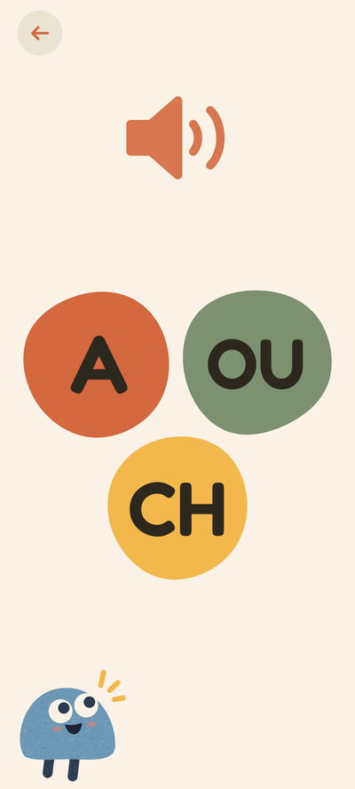
  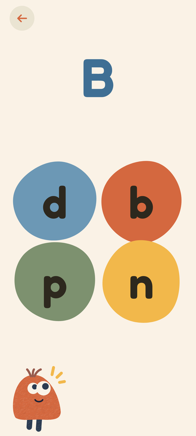
</p>

## How a child learns

**Cards.** Each French sound, syllable and word has its own cards, scheduled
separately like the sides of an Anki note:

- **Voir et dire** (see and say): a grapheme fills the screen and the child
  says its sound. For now the parent sitting next to the child gives the verdict
  with the small ✓ / ✗ buttons.
- **Écouter et choisir** (listen and choose): Lulu plays a sound and the child
  taps the matching grapheme among 2 to 4 pebbles. Decoys are sounds already met,
  and look-alikes (on and an, p and b, m and n) once the card is solid.
- **Capitals, then lower case**: each sound is learned in capitals first. Once
  both capital cards are solid, Lulu shows the lower case next to the capital,
  then asks to match « B » with « b » and to pick the lower-case letter out by
  ear, with look-alike letters (b, d, p) as decoys later on.
- **Syllables**: as soon as a consonant and a few vowels are known, Lulu builds
  syllables from them: consonant-vowel (LA, BU), then the inverse pairs (FOU and
  OUF, to show that the order of letters matters), then POUL, FOUR, then TRI,
  FLA. Many are invented on purpose, so the child decodes instead of
  recognising. A new syllable is shown sound by sound, then the sounds slide
  together: « L… A… LA ».
- **Words**: about 85 words a 3-year-old knows (chou, vélo, loup, lapin, fleur…),
  each offered only when all its sounds are known, open syllables first. Silent
  letters are grey, as in French first readers, and the word's picture appears
  only after the child has read it, never before.

**One answer per card, as in Anki.** A right answer is rated « Bien » (or
« Difficile » if the child asked to hear the sound first). A wrong answer is
rated « À revoir »: Lulu shows or says the right sound, then moves on. The missed
card is due again a few minutes later, so it comes back later in the session.

**Progression.** Levels 1 to 4 follow the CSEN note of September 2025: vowels
(a, é, i, o, u, eu, ou), consonants you can hold (f, ch, j, v, s, l, r), nasal
vowels (on, an, in, un), then short and nasal consonants (p, b, t, d, qu, m, n,
gn). Level 5 follows the rest of the Sprenger-Charolles and Dehaene progression
published by Éduscol: e (as in « le »), z, hard c and g, oi, au and eau, è, ai,
en, ain, and soft c and g (CE, GI) through syllables and words. Syllables (level
6) and words (level 7) run alongside. The sound of the first letter of the
child's name comes early.

**Sessions.** The parent sets one thing: how long a session lasts (5 minutes by
default). Lulu fills that time and picks each next card from the child's answers:

1. something new, after a warm-up of 3 cards and up to 3 a day: a sound (2 a day
   at most), a syllable (2), a word (2) or a lower case (1), the kinds taking
   turns. Only once what is there holds: not while the cards waiting to be
   reviewed would fill more than 60 % of the time left, not when more than 4 of
   the last 20 answers were missed, not right after two misses, not in the last
   minute;
2. cards that are due, the most overdue first;
3. practice on items being learned, early review, and then whatever was seen
   longest ago.

FSRS aims at 95 % recall rather than Anki's 90 %: its default parameters come
from adults, and a 3-year-old's first weeks recalled less than they predicted.
« Voir et dire » opens once the child picks the sound out by ear reliably (two
successes): recognising comes before saying. Once « voir et dire » is solid,
the stepping-stone cards (« écouter et choisir », capital to lower case) are not
asked any more, so that reviews keep fitting in a short session; they come back
if reading slips.

An item just met waits for 3 other cards before its first question, so the
child does not simply echo what Lulu said. When the child chooses by ear, no two
choices sound the same (AU and O, C and QU). When time is up, the card on screen
is finished and the session ends.

<p align="center">
  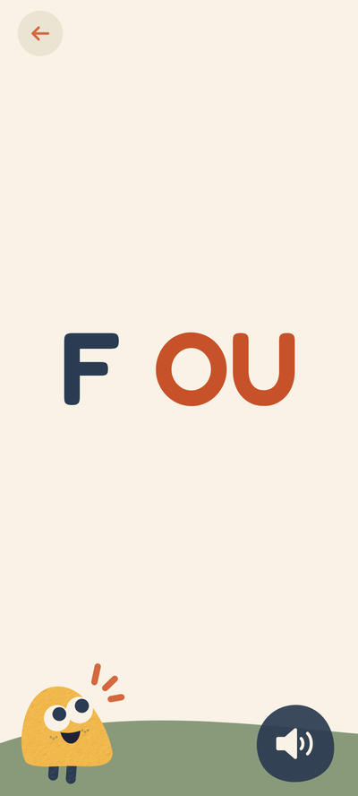
  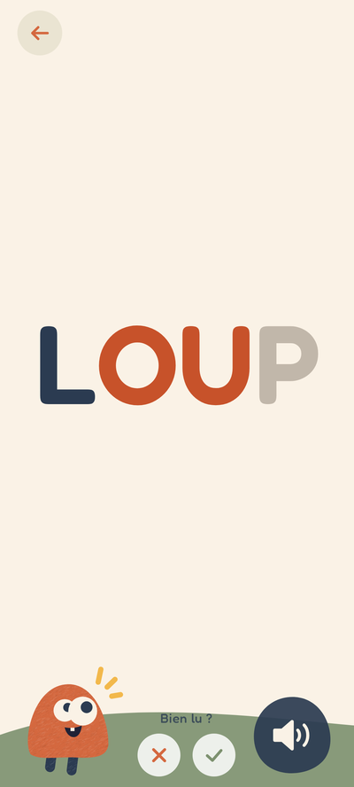
  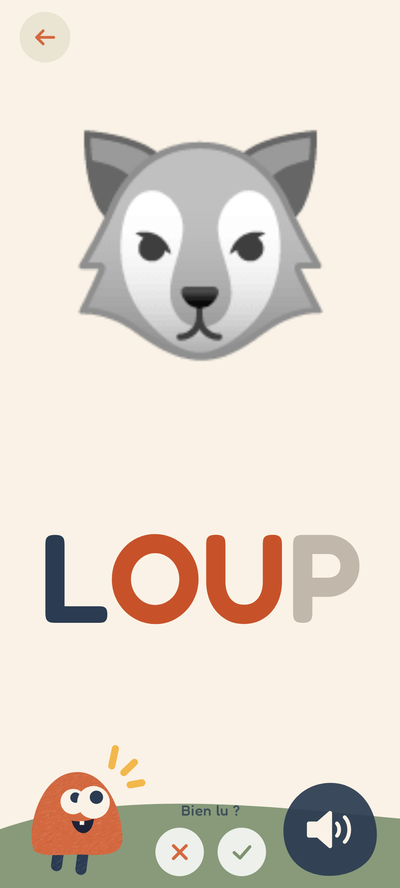
  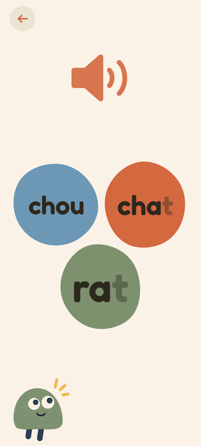
</p>

<p align="center">
  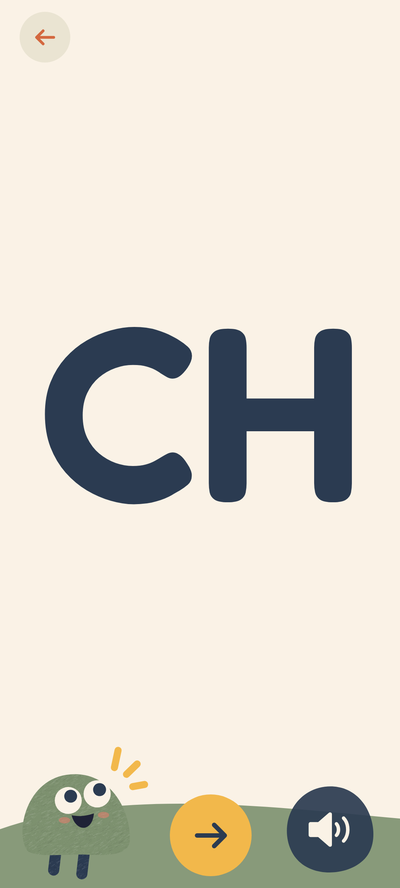
  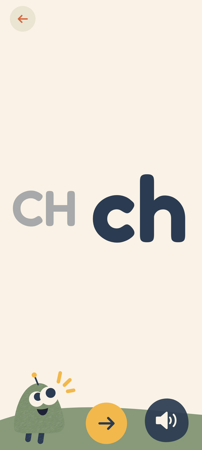
  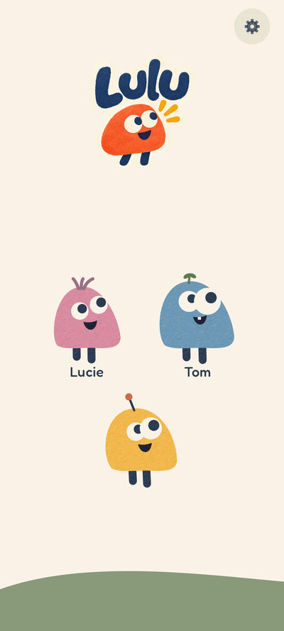
  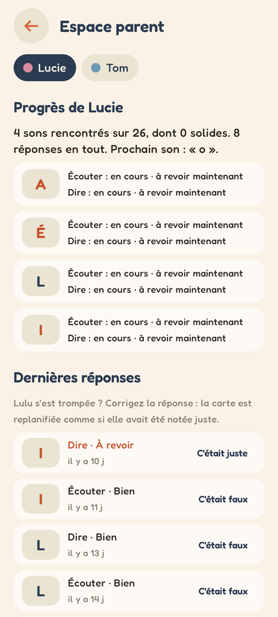
</p>

## Each child has their own Lulu

Children pick themselves by their mascot, since they cannot read yet. Each
mascot gets a colour chosen by the parent and a personality drawn at random: its
silhouette, eyes, mouth, a detail (a tuft, a sprout, an antenna, freckles) and an
idle habit (looking around, hopping, wiggling). It listens, cheers and jumps
with the child, in the style of the logo.

<p align="center">
  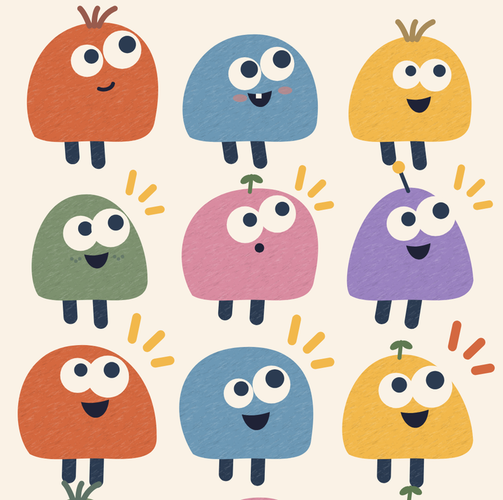
</p>

The art direction keeps one thing to look at per screen: big rounded letters,
a short warm palette, soft marimba-like sounds whose pitch climbs with a streak,
squash-and-bounce on every tap, and never an error buzzer.

## Parent area

Behind a small lock a 3-year-old cannot open (a multiplication), the parent can:

- follow progress for each sound, in capitals and in lower case;
- correct a past answer: the card is replayed from its review history as if it
  had been rated the other way;
- set the session length;
- export all the data (profiles, cards, every answer with its time) as one JSON
  file, to share or keep; voice recordings are not included;
- record their own voice for each reference sound;
- add, edit or remove children.

## Status

Not done yet:

- **Speech recognition.** The parent gives the « voir et dire » verdict. An
  on-device phoneme model (wav2vec2) is the next milestone and will plug into
  the same flow.
- **Reference voice.** Sounds play the parent's recording when there is one (a
  sound like « au » borrows the recording of « o »), else French text-to-speech,
  which is fine for vowels but only approximate for consonants. Syllables and
  words always use text-to-speech.

## Under the hood

- `core/`: plain Kotlin, no Android. The FSRS-6 scheduler (`fsrs/`), ported from
  py-fsrs 6.3.3 and checked against 433 reviews it generated; sounds, syllables,
  words and progression (`content/`); progress and JSON storage (`store/`);
  session planning (`session/`).
- `app/`: the Android app in Jetpack Compose. Screens in `ui/screens/`, the
  mascot, icons and shared pieces in `ui/components/`, sounds in `audio/`.

Build and test (JDK 17+ and the Android SDK, compileSdk 37.2):

```sh
./gradlew :core:test                 # FSRS, progression, sessions, storage
./gradlew :app:testDebugUnitTest     # session view model (Robolectric)
./gradlew :app:assembleDebug         # app/build/outputs/apk/debug/app-debug.apk
./gradlew :app:recordRoborazziDebug  # renders the screens to app/build/screenshots/
```

The screenshots in this README come from `recordRoborazziDebug`. To regenerate
the FSRS reference vectors: `pip install fsrs==6.3.3`, then
`python core/src/test/resources/fsrs/gen_fsrs_vectors.py > core/src/test/resources/fsrs/py-fsrs-vectors.json`.

## Credits

Fredoka font by the Fredoka Project Authors, under the SIL Open Font License
(`licenses/Fredoka-OFL.txt`). The bundled copies close the gap in the capital B
so that children see its usual shape (`tools/fix_fredoka_b.py`).
